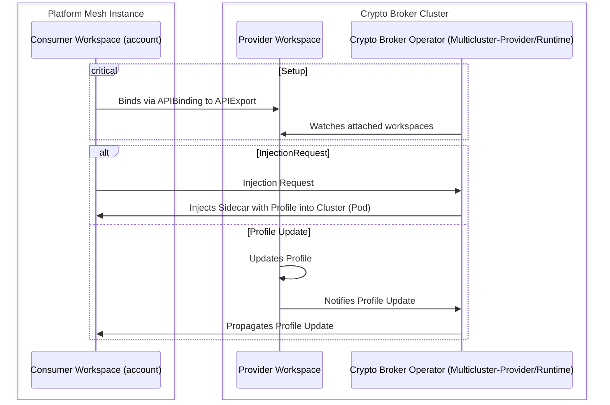

# Crypto Broker Multi-cluster Architecture on Platform Mesh

This document describes the architecture and deployment of the Crypto Broker Multi-cluster setup on Platform Mesh, highlighting the key components, interactions, and configuration considerations for multi-cluster environments.

## Current Architecture

At the moment the Crypto Broker Operator manages the deployment and lifecycle of the Crypto Broker components within a single workspace.
Each workspace needs to install the Crypto Broker Operator to be able to inject the Crypto Broker Server and profile into a workload, if a request for such an injection is made.
Additionally, the profiles for the Crypto Broker Server are only available for this workspace.

## Multi-cluster(workspace) Considerations

The current architecture is limited to a single workspace, which means that each workspace operates independently with its own instance of the Crypto Broker Operator and Crypto Broker Server profiles.
To avoid that each workspace needs to independently manage its own Crypto Broker Server profiles, a centralized provider workspace can be introduced to share configurations and profiles with consumer workspaces.
In a multi-cluster(workspace) setup, the goal is to centralize certain configurations and enable seamless interaction between multiple clusters(workspaces), reducing duplication and improving manageability.
Three main steps need to be taken to enable multi-cluster(workspace) support for the Crypto Broker Cluster setup:

- The Crypto Broker Operator needs to be able to interact with consumer workspaces and manage the injection of the Crypto Broker Server and profiles across multiple clusters by having access to the necessary kubeconfig file for each consumer workspace.
- The Crypto Broker Operator needs to support multi-cluster management (see [multicluster-runtime architecture](https://platform-mesh.io/main/concepts/integration/multicluster-runtime.html#architecture) and [multicluster-runtime-repo](https://github.com/kubernetes-sigs/multicluster-runtime/tree/main))
- The Crypto Broker Operator needs to implement admission webhooks for profile management (see [admission webhooks](https://github.com/platform-mesh/platform-mesh/blob/main/apis/core/v1alpha1/account_webhook.go)).

In order to achieve this, the current workspace needs to be transformed into a [provider workspace](https://github.com/kcp-dev/multicluster-provider) that can expose the APIExport to other (consumer-)workspaces.
When a consumer cluster requests the injection of the Crypto Broker Server and profiles, the provider workspace needs access to the kubeconfig to be able to interact with the consumer cluster and perform the necessary injection operations.
The Crypto Broker provider workspace holds the Crypto Broker Operator, which needs to manage and expose the Crypto Broker Server and profiles for consumption by other workspaces.
The Crypto Broker operator therefore needs to be able to interact with consumer workspaces via the multi-cluster runtime.
Furthermore, the Crypto Broker Server profiles will be centrally available in the Crypto Broker provider workspace, but can be adjusted by responsible actors within that workspace (how this can be achieved is still under consideration).
To enable this interaction, the Crypto Broker Operator will also need to integrate the admission webhooks for profile management.
The admission webhooks will therefore allow the operator to check, when a new injection request is made, whether the selected profile is available and can then inject this profile along the Crypto Broker Server into the consumer cluster (pod) accordingly.
The Crypto Broker Operator keeps track of the profiles and if any changes are made from the provider workspace, it will propagate these changes to the consumer clusters to ensure consistency and proper injection of the updated profiles.

In summary, the multi-cluster(workspace) setup for the Crypto Broker platform involves transforming the current workspace into a [provider workspace](https://github.com/kcp-dev/multicluster-provider), centralizing the management of the Crypto Broker Server and profiles, and enabling seamless interaction with consumer workspaces through the multi-cluster runtime and admission webhooks.
This approach ensures consistency, reduces duplication, and improves the overall manageability of the Crypto Broker platform across multiple clusters(workspaces).

## Architecture Diagram

The following diagram illustrates the multi-cluster(workspace) setup for the Crypto Broker platform, highlighting the provider workspace, consumer workspaces, and the interactions facilitated by the multi-cluster runtime and admission webhooks.

```ascii
┌────────────────────────────────────────────────────────────────────────────────────────┐
│  PM-Instance                                                                           │
│ ┌──────────────────┐  ┌──────────────────┐  ┌──────────────────┐  ┌──────────────────┐ │
│ │Workspace(account)│  │Workspace(account)│  │Workspace(account)│  │Workspace(account)│ │
│ │                  │  │                  │  │                  │  │                  │ │
│ │┌────────────────┐│  │┌────────────────┐│  │┌────────────────┐│  │┌────────────────┐│ │
│ ││APIBinding      ┼┼─┬┼┼APIBinding      ││ ┌┼┤APIBinding      ││ ┌┼┼APIBinding      ││ │
│ │└────────────────┘│ ││└────────────────┘│ ││└────────────────┘│ ││└────────────────┘│ │
│ │                  │ ││                  │ ││                  │ ││                  │ │
│ │                  │ ││                  │ ││┌────────────────┐│ ││                  │ │
│ │                  │ ││                  │ │││SimpleCluster   ││ ││                  │ │
│ │                  │ ││                  │ ││└▲───────────────┘│ ││                  │ │
│ │                  │ ││                  │ ││ │                │ ││                  │ │
│ └──────────────────┘ │└──────────────────┘ │└─┼────────────────┘ │└──────────────────┘ │
│                      │                     │  │                  │                     │
│ ┌───────────────────┐│                     │  │                  │                     │   ┌────────────────────┐
│ │Workspace(provider)││                     │  └──────────────────┼─────────────────────┼───┼SimpleCluster       │
│ │┌─────────────────┐││                     │                     │                     │   │                    │
│ ││APIExport       ◄┼┼┴─────────────────────┴─────────────────────┘                     │   │ ┌────────────────┐ │
│ │└─────────────────┘│                                                                  │   │ │Pod             │ │
│ │┌─────────────────┐│    ┌───────────────────────────────────────────────────────┐     │   │ ┼────────────────┼ │
│ ││kubeconfig       ││    │                 Crypto Broker Cluster                 │     │   │ │┌──────────────┐│ │
│ │└▲────────────────┘│    │ ┌───────────────────────┐                             │     │   │ ││Container     ││ │
│ │ └─────────────────┼────┼─┼Crypto Broker Operator │                             │     │   │ │└──────────────┘│ │
│ │                   │    │ │                       │                             │     │   │ │┌──────────────┐│ │
│ │                   │    │ └───────────────────────┘                             │     │   │ ││Container     ││ │
│ │                   │    │                                                       │     │   │ │└──────────────┘│ │
│ └───────────────────┘    └───────────────────────────────────────────────────────┘     │   │ └────────────────┘ │
└────────────────────────────────────────────────────────────────────────────────────────┘   └────────────────────┘
```

## Sequence Diagram

The sequence diagram illustrates the interaction between the consumer workspace, provider workspace, and the crypto broker operator during the setup phase, an injection request, and profile update processes.


