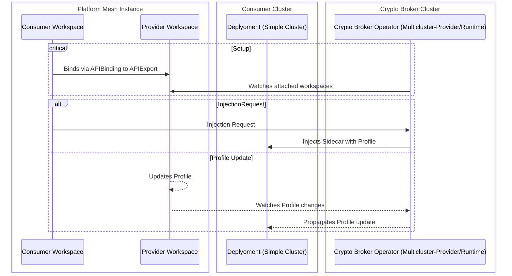

# Crypto Broker Multi-Workspace Architecture on Platform Mesh

This document describes the architecture and deployment of the Crypto Broker Multi-Workspace setup on Platform Mesh, highlighting the key components, interactions, and configuration considerations for multi-workspace environments.

## Current Architecture

At the moment the Crypto Broker Operator manages the deployment and lifecycle of the Crypto Broker components within a single workspace.
Each workspace needs to install the Crypto Broker Operator to be able to inject the Crypto Broker Server and profile into a workload, if a request for such an injection is made.
Additionally, the profiles for the Crypto Broker Server are only available for this workspace.

## Multi-Workspace Considerations

The current architecture is limited to a single workspace, which means that each workspace operates independently with its own instance of the Crypto Broker Operator and Crypto Broker Server profiles.
To avoid that each workspace needs to independently manage its own Crypto Broker Operator and Server profiles, a centralized provider workspace can be introduced to have one Crypto Broker Operator and one set of Server profiles shared with different consumer workspaces.
This approach reduces duplication and improves manageability of the Crypto Broker Operator and the associated Server profiles across multiple workspaces.

Three main steps need to be taken to enable multi-workspace support for the Crypto Broker Cluster setup:

- The Crypto Broker Operator needs to be able to interact with consumer workspaces and manage the injection of the Crypto Broker Server and Server profiles into consumer clusters by having access to the necessary kubeconfig for these clusters (e.g. SimpleCluster).
- The Crypto Broker Operator needs to support multi-cluster management (see [multicluster-runtime architecture](https://platform-mesh.io/main/concepts/integration/multicluster-runtime.html#architecture) and [multicluster-runtime-repo](https://github.com/kubernetes-sigs/multicluster-runtime/tree/main))
- The Crypto Broker Operator needs to implement admission webhooks for profile management (see [admission webhooks](https://github.com/platform-mesh/platform-mesh/blob/main/apis/core/v1alpha1/account_webhook.go)).

In order to achieve this, the current workspace needs to be transformed into a [provider workspace](https://github.com/kcp-dev/multicluster-provider) that exposes the APIExport and consumer workspaces can bind via the APIBinding to it.
When a consumer workspace requests the injection of the Crypto Broker Server and Server profiles, the Crypto Broker Operator needs access to the kubeconfig of the consumer cluster (which lives in this consumer workspace) to be able to interact with the consumer cluster and perform the necessary injection operations.
The necessary rights and permissions must be granted in the kubeconfig for the Crypto Broker Operator to be able to perform the required operations in the consumer cluster.

The Crypto Broker provider workspace holds the APIExport and the Server profiles for the Crypto Broker Server, but no actual workload (i.e., no running instances of the Crypto Broker Server).
The Crypto Broker operator runs in its own cluster and has a kubeconfig to the provider workspace in order to reconcile the virtual workspaces (representing the consumer workspaces), which is introduced by the APIExport.

Furthermore, the Server profiles will be centrally available in the Crypto Broker provider workspace, but can be adjusted by responsible actors within that workspace (how this can be achieved is still under consideration).
To enable this interaction, the Crypto Broker Operator needs to integrate the admission webhooks for profile management.
The admission webhook allows the operator to check, when a new injection request is made, whether the selected profile is existing.
The Crypto Broker Operator will then proceed with the injection of the Crypto Broker Server as a sidecar and the Server profile will be injected only if the Server profile exists and is valid.
The Crypto Broker Operator keeps track of the Server profiles and if any changes are made from the provider workspace, it will propagate these changes to the consumer clusters to ensure consistency and proper injection of the updated Server profiles.

In summary, the multi-workspace setup for the Crypto Broker cluster involves transforming the current workspace into a [provider workspace](https://github.com/kcp-dev/multicluster-provider), centralizing the management of the Crypto Broker Operator and Server profiles, and enabling seamless interaction with consumer workspaces through the multi-cluster runtime and admission webhooks.
This approach ensures consistency, reduces duplication, and improves the overall manageability of the Crypto Broker cluster across multiple workspaces.

## Architecture Diagram

The following diagram illustrates the multi-workspace setup for the Crypto Broker platform, highlighting the provider workspace, consumer workspaces, and the interactions facilitated by the multi-cluster runtime and admission webhooks.

```ascii
┌────────────────────────────────────────────────────────────────────────────────────────┐
│  PM-Instance                                                                           │
│ ┌──────────────────┐  ┌──────────────────┐  ┌──────────────────┐  ┌──────────────────┐ │
│ │Consumer WS       │  │Consumer WS       │  │Consumer WS       │  │Consumer WS       │ │
│ │                  │  │                  │  │                  │  │                  │ │
│ │┌────────────────┐│  │┌────────────────┐│  │┌────────────────┐│  │┌────────────────┐│ │
│ ││APIBinding      ┼┼─┬┼┼APIBinding      ││ ┌┼┤APIBinding      ││ ┌┼┼APIBinding      ││ │
│ │└────────────────┘│ ││└────────────────┘│ ││└────────────────┘│ ││└────────────────┘│ │
│ │                  │ ││                  │ ││                  │ ││                  │ │
│ │                  │ ││                  │ ││┌────────────────┐│ ││                  │ │
│ │                  │ ││                  │ │││SimpleCluster   ││ ││                  │ │
│ │                  │ ││                  │ ││└▲───────────────┘│ ││                  │ │
│ │                  │ ││                  │ ││ │                │ ││                  │ │
│ └──────────────────┘ │└──────────────────┘ │└─┼────────────────┘ │└──────────────────┘ │
│                      │                     │  │                  │                     │
│ ┌───────────────────┐│                     │  │                  │                     │   ┌────────────────────┐
│ │Provider WS        ││                     │  └──────────────────┼─────────────────────┼───┼SimpleCluster       │
│ │┌─────────────────┐││                     │                     │                     │   │                    │
│ ││APIExport       ◄┼┼┴─────────────────────┴─────────────────────┘                     │   │ ┌────────────────┐ │
│ │└─────────────────┘│                                                                  │   │ │Pod             │ │
│ │┌─────────────────┐│    ┌───────────────────────────────────────────────────────┐     │   │ ┼────────────────┼ │
│ ││kubeconfig       ││    │                 Crypto Broker Cluster                 │     │   │ │┌──────────────┐│ │
│ │└▲────────────────┘│    │ ┌───────────────────────┐                             │     │   │ ││Container     ││ │
│ │ └─────────────────┼────┼─┼Crypto Broker Operator │                             │     │   │ │└──────────────┘│ │
│ │                   │    │ │                       │                             │     │   │ │┌──────────────┐│ │
│ │                   │    │ └───────────────────────┘                             │     │   │ ││Container     ││ │
│ │                   │    │                                                       │     │   │ │└──────────────┘│ │
│ └───────────────────┘    └───────────────────────────────────────────────────────┘     │   │ └────────────────┘ │
└────────────────────────────────────────────────────────────────────────────────────────┘   └────────────────────┘
```

## Sequence Diagram

The sequence diagram illustrates the interaction between the consumer workspace, provider workspace, and the crypto broker cluster during the setup phase, an injection request, and profile update processes.


